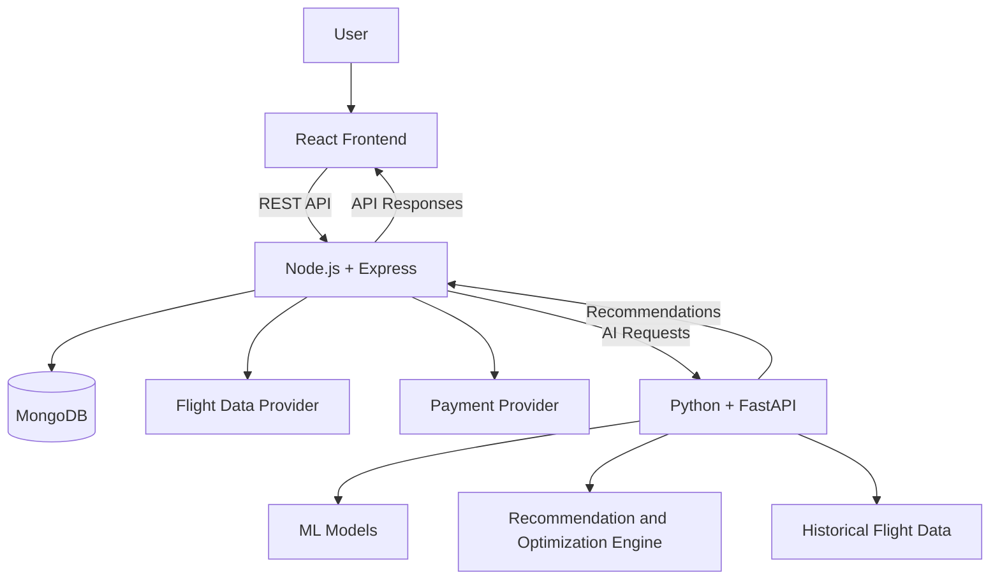
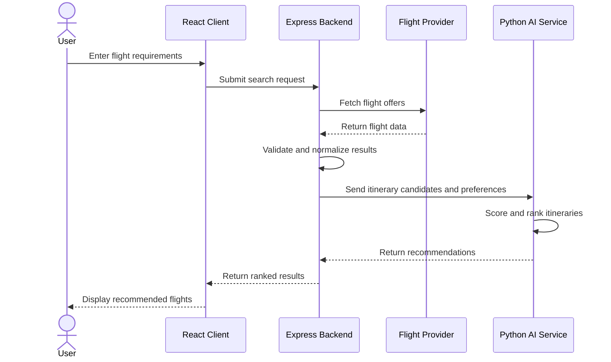
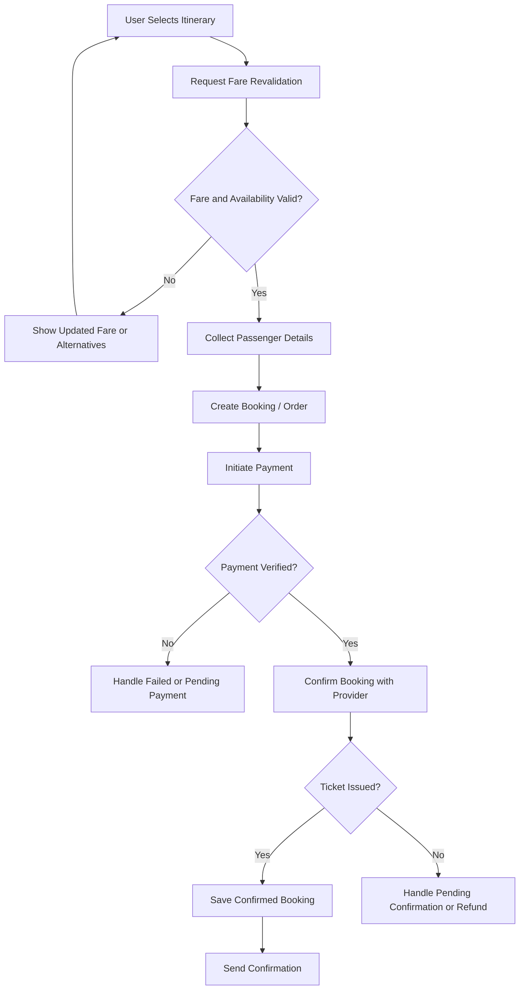

# AeroWise – System Architecture

## 1. Architecture Overview

AeroWise follows a modular client-server architecture with a separate AI microservice.

The system consists of five major components:

1. React Frontend
2. Node.js + Express Backend
3. MongoDB Database
4. Python AI Service
5. External Flight Data and Payment Providers

## 2. High-Level Architecture



## 3. Frontend Architecture

**Technology:** React.js, Tailwind CSS, Redux Toolkit, React Router.

Responsibilities:

- User interface.
- User authentication interface.
- Flight search.
- Flight result display.
- Flight comparison.
- Recommendation display.
- Booking interface.
- Payment interface.
- User dashboard.
- Booking history.

### Frontend Structure

```text
Client/
│
├── public/
│
├── src/
│   ├── assets/
│   │
│   ├── components/
│   │   ├── common/
│   │   ├── navbar/
│   │   ├── flight/
│   │   ├── booking/
│   │   └── recommendations/
│   │
│   ├── pages/
│   │   ├── Home.jsx
│   │   ├── SearchFlights.jsx
│   │   ├── FlightDetails.jsx
│   │   ├── Booking.jsx
│   │   ├── MyBookings.jsx
│   │   └── Profile.jsx
│   │
│   ├── layouts/
│   │
│   ├── hooks/
│   │
│   ├── redux/
│   │   ├── store.js
│   │   └── slices/
│   │
│   ├── services/
│   │
│   ├── utils/
│   │
│   ├── App.jsx
│   └── main.jsx
│
└── package.json
```

## 4. Backend Architecture

**Technology:** Node.js, Express.js, MongoDB and Mongoose.

Responsibilities:

- Authentication and authorization.
- User management.
- Flight search API integration.
- Flight data processing.
- Connecting itinerary generation.
- Booking management.
- Payment verification.
- Communication with the AI service.
- Request validation and error handling.

### Backend Structure

```text
Server/
│
├── config/
│   ├── db.js
│   └── environment.js
│
├── controllers/
│   ├── user.controller.js
│   ├── flight.controller.js
│   ├── booking.controller.js
│   ├── payment.controller.js
│   └── recommendation.controller.js
│
├── models/
│   ├── user.model.js
│   ├── airport.model.js
│   ├── booking.model.js
│   ├── payment.model.js
│   └── userPreference.model.js
│
├── routes/
│   ├── user.route.js
│   ├── flight.route.js
│   ├── booking.route.js
│   ├── payment.route.js
│   └── recommendation.route.js
│
├── middlewares/
│   ├── authentication.js
│   ├── authorization.js
│   ├── errorHandler.js
│   └── validateRequest.js
│
├── services/
│   ├── flightProvider.service.js
│   ├── itinerary.service.js
│   ├── booking.service.js
│   ├── payment.service.js
│   └── ai.service.js
│
├── validators/
│
├── utils/
│
├── server.js
└── package.json
```

## 5. AI Service Architecture

**Technology:** Python, FastAPI, Pandas, NumPy and Scikit-learn.

The AI service will independently handle intelligent operations.

### Responsibilities

1. Flight recommendation.
2. Multi-objective ranking.
3. Route optimization.
4. Flight price prediction.
5. Flight delay prediction.
6. Natural-language search interpretation.

### AI Service Structure

```text
AI-Service/
│
├── data/
│   ├── raw/
│   └── processed/
│
├── notebooks/
│
├── models/
│
├── preprocessing/
│   ├── clean_data.py
│   └── feature_engineering.py
│
├── recommendations/
│   ├── scoring.py
│   └── ranking.py
│
├── optimization/
│   ├── route_optimizer.py
│   └── itinerary_generator.py
│
├── predictions/
│   ├── price_predictor.py
│   └── delay_predictor.py
│
├── schemas/
│
├── main.py
└── requirements.txt
```

## 6. Flight Search and Recommendation Workflow



## 7. Booking Workflow



## 8. Communication Between Services

### React to Express

REST APIs over HTTP/HTTPS.

Example:

```http
GET /api/v1/flights/search
```

### Express to MongoDB

Mongoose ODM.

Used for:
- User records.
- Preferences.
- Bookings.
- Payment records.
- Cached reference information.

### Express to Flight Provider

Provider-specific APIs for:
- Airport and location search.
- Flight offers.
- Fare verification.
- Booking and ticket issuance.

### Express to Python AI

Internal REST API using FastAPI.

Example:

```http
POST /api/v1/recommendations/rank
```

Example request:

```json
{
  "preferences": {
    "maxBudget": 40000,
    "maxStops": 1,
    "priority": "balanced"
  },
  "itineraries": []
}
```

The actual request will contain normalized itinerary data.

### Python AI to Express

Returns:
- Itinerary identifier.
- Recommendation score.
- Ranking.
- Recommendation category.
- Explanation.

## 9. Important Architectural Decisions

1. Express is the primary backend and owns application business logic.
2. Python is responsible for AI and optimization.
3. MongoDB stores application data and booking snapshots.
4. Flight providers remain the source of truth for live availability and fares.
5. The AI service does not directly confirm or issue flight tickets.
6. Payment success must be verified through the payment provider.
7. Booking operations must be protected against duplicate requests.
8. External API failures must be handled gracefully.
9. AI recommendations should never override mandatory booking constraints.

## 10. Future Scalability

Potential future improvements:

- Redis for caching.
- Background workers for price monitoring.
- Message queues for asynchronous operations.
- WebSockets for live updates.
- Containerization with Docker.
- Centralized logging and monitoring.
- Independent deployment of the AI service.

These components should be introduced when required rather than added unnecessarily during the initial development.