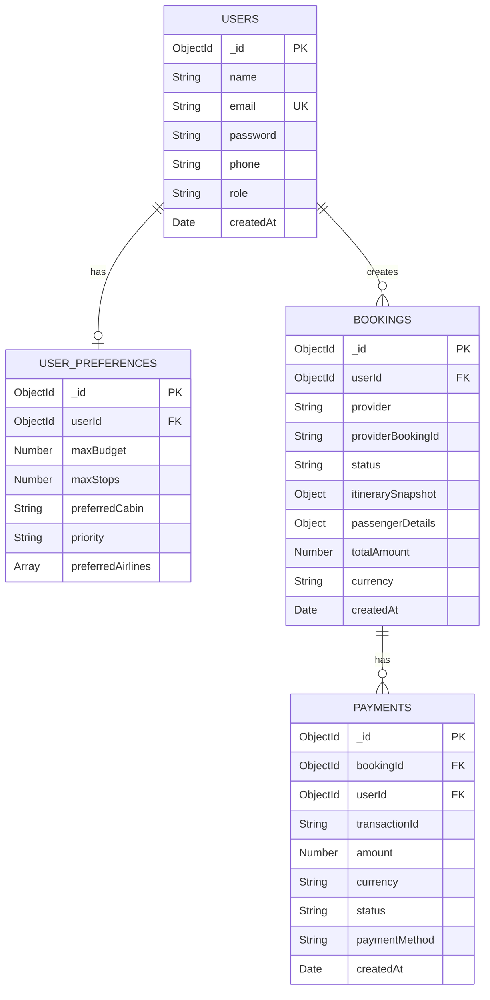

# AeroWise – Database Schema

## 1. Database Overview

**Database:** MongoDB

**ODM:** Mongoose

AeroWise uses a document-oriented database to store user information, travel preferences, airport information, booking details and payment records.

### Main Collections

1. Users
2. Airports
3. UserPreferences
4. Bookings
5. Payments

Flight offers are initially retrieved from external flight providers. They are not treated as permanent database records because fares and availability change frequently.

## 2. Database Relationship Diagram



Airports are independent reference records and are referenced by their IATA codes in flight search requests and itinerary snapshots.

## 3. Users Collection

**Collection:** `users`

Stores registered user information.

### Fields

| Field | Type | Description |
|---|---|---|
| _id | ObjectId | Unique user ID |
| name | String | Full name |
| email | String | Unique email |
| password | String | Hashed password |
| phone | String | Phone number |
| avatar | String | Profile image URL |
| role | String | User or admin |
| isVerified | Boolean | Email verification status |
| createdAt | Date | Account creation date |
| updatedAt | Date | Last update |

### Example Document

```json
{
  "_id": "USER_ID",
  "name": "Harish Kumar",
  "email": "harish@example.com",
  "password": "HASHED_PASSWORD",
  "phone": "+919876543210",
  "avatar": "",
  "role": "user",
  "isVerified": false
}
```

Security considerations:
- Never store plain-text passwords.
- Never return password hashes in API responses.
- Enforce unique email addresses.
- Validate user input.
- Keep authentication tokens in secure cookies when using cookie-based authentication.

## 4. Airports Collection

**Collection:** `airports`

Stores airport reference information.

### Fields

| Field | Type | Description |
|---|---|---|
| _id | ObjectId | Airport ID |
| iataCode | String | Three-letter airport code |
| icaoCode | String | ICAO airport code |
| name | String | Airport name |
| city | String | City |
| country | String | Country |
| countryCode | String | Country code |
| latitude | Number | Geographic latitude |
| longitude | Number | Geographic longitude |
| timezone | String | Airport timezone |

### Example Document

```json
{
  "iataCode": "DEL",
  "icaoCode": "VIDP",
  "name": "Indira Gandhi International Airport",
  "city": "New Delhi",
  "country": "India",
  "countryCode": "IN",
  "latitude": 28.5562,
  "longitude": 77.1000,
  "timezone": "Asia/Kolkata"
}
```

### Important Indexes

- Unique index on `iataCode`.
- Text or search index for airport names and cities.

Airport data can initially come from an external airport dataset or provider.

## 5. UserPreferences Collection

**Collection:** `userpreferences`

Stores individual travel preferences for personalized recommendations.

### Fields

| Field | Type | Description |
|---|---|---|
| _id | ObjectId | Preference ID |
| userId | ObjectId | Reference to user |
| maxBudget | Number | Preferred maximum budget |
| preferredAirlines | Array | Preferred airline codes |
| excludedAirlines | Array | Airlines to avoid |
| maxStops | Number | Maximum stopovers |
| maxDuration | Number | Maximum journey duration in minutes |
| preferredCabin | String | Economy, Business, First |
| preferredLayover | Object | Minimum and maximum layover duration |
| priority | String | Cheapest, fastest, balanced, quality |
| weights | Object | Recommendation weights |
| updatedAt | Date | Last preference update |

### Example Document

```json
{
  "userId": "USER_ID",
  "maxBudget": 40000,
  "preferredAirlines": ["AI", "EK"],
  "excludedAirlines": [],
  "maxStops": 1,
  "maxDuration": 1200,
  "preferredCabin": "Economy",
  "preferredLayover": {
    "minMinutes": 90,
    "maxMinutes": 300
  },
  "priority": "balanced",
  "weights": {
    "price": 0.5,
    "duration": 0.2,
    "stopovers": 0.2,
    "quality": 0.1
  }
}
```

The weights should be validated and normalized before being used by the recommendation engine.

## 6. Bookings Collection

**Collection:** `bookings`

Stores user booking information and itinerary snapshots.

### Fields

| Field | Type | Description |
|---|---|---|
| _id | ObjectId | Booking ID |
| bookingReference | String | Internal booking reference |
| userId | ObjectId | Reference to user |
| provider | String | Flight booking provider |
| providerBookingId | String | External booking reference |
| itinerarySnapshot | Object | Selected flight itinerary |
| passengerDetails | Array | Passenger information |
| totalAmount | Number | Booking amount |
| currency | String | Currency code |
| status | String | Booking status |
| createdAt | Date | Booking creation time |
| updatedAt | Date | Last update |

### Possible Booking Statuses

- pending
- payment_pending
- confirmed
- ticketed
- failed
- cancelled
- refund_pending
- refunded

### Itinerary Snapshot Structure

```json
{
  "segments": [
    {
      "origin": "DEL",
      "destination": "DXB",
      "airline": "AI",
      "flightNumber": "AI995",
      "departureAt": "2027-01-15T10:00:00+05:30",
      "arrivalAt": "2027-01-15T12:30:00+04:00"
    },
    {
      "origin": "DXB",
      "destination": "LHR",
      "airline": "EK",
      "flightNumber": "EK001",
      "departureAt": "2027-01-15T15:00:00+04:00",
      "arrivalAt": "2027-01-15T19:00:00+00:00"
    }
  ],
  "totalDurationMinutes": 840,
  "numberOfStops": 1,
  "currency": "INR",
  "totalPrice": 40000
}
```

This is an illustrative snapshot. Actual booking information must be taken from the booking provider's confirmed response.

### Important Considerations

- Preserve the selected itinerary at booking time.
- Store external provider references.
- Revalidate fares before booking.
- Avoid storing unnecessary sensitive passenger data.
- Encrypt sensitive data where appropriate.
- Handle duplicate booking requests using idempotency mechanisms.

## 7. Payments Collection

**Collection:** `payments`

Stores payment transaction information.

### Fields

| Field | Type | Description |
|---|---|---|
| _id | ObjectId | Payment ID |
| bookingId | ObjectId | Reference to booking |
| userId | ObjectId | Reference to user |
| transactionId | String | Gateway transaction ID |
| amount | Number | Payment amount |
| currency | String | Currency code |
| status | String | Payment status |
| paymentMethod | String | Payment method |
| gateway | String | Payment provider |
| createdAt | Date | Payment creation date |

### Possible Payment Statuses

- initiated
- processing
- succeeded
- failed
- refunded

### Example Document

```json
{
  "bookingId": "BOOKING_ID",
  "userId": "USER_ID",
  "transactionId": "GATEWAY_TRANSACTION_ID",
  "amount": 40000,
  "currency": "INR",
  "status": "succeeded",
  "paymentMethod": "card",
  "gateway": "stripe"
}
```

Never store card numbers, CVVs or other raw payment credentials.

Payment status must be verified through trusted payment gateway responses or webhooks.

## 8. Database Indexing Strategy

Recommended indexes:

| Collection | Index |
|---|---|
| Users | Unique email |
| Airports | Unique IATA code |
| UserPreferences | Unique userId |
| Bookings | userId + createdAt |
| Bookings | Unique bookingReference |
| Bookings | providerBookingId |
| Payments | bookingId |
| Payments | Unique gateway transaction ID |

Use indexes according to actual query patterns and provider requirements.

## 9. Important Design Decisions

### Why store itinerary snapshots?

Flight information and prices can change after a booking is made.

A booking must preserve the itinerary and fare details associated with the actual booking, rather than relying on a live flight search result.

### Why separate payments and bookings?

A booking and its payment have different lifecycles.

For example:
- A booking may be pending while payment is processing.
- A payment may succeed while ticket issuance is still pending.
- A booking may be cancelled after a successful payment.
- A refund may be processed separately.

Separating these collections makes payment reconciliation easier.

### Why not permanently store every flight search result?

Flight fares and availability change frequently. External flight providers should remain the source of truth.

Temporary caching can be introduced later with expiration rules.

## 10. Future Database Enhancements

As AeroWise grows, additional collections may be introduced:

| Collection | Purpose |
|---|---|
| SearchHistory | Store previous user searches |
| PriceAlerts | Monitor flight price changes |
| PriceHistory | Store historical price observations |
| Reviews | Store airline and travel reviews |
| Notifications | Store booking and price alerts |
| AIRecommendations | Store recommendation history |
| SavedItineraries | Allow users to save flight options |

These collections are not required for the initial MVP.